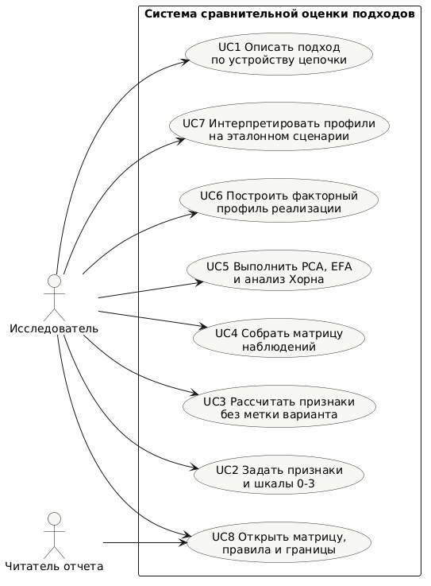
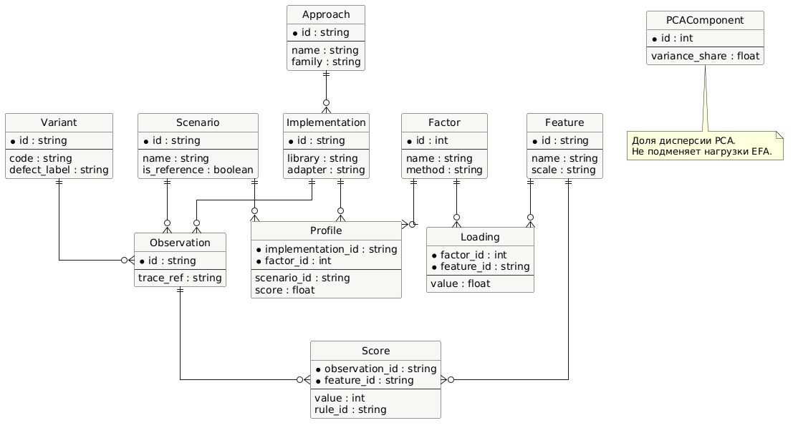
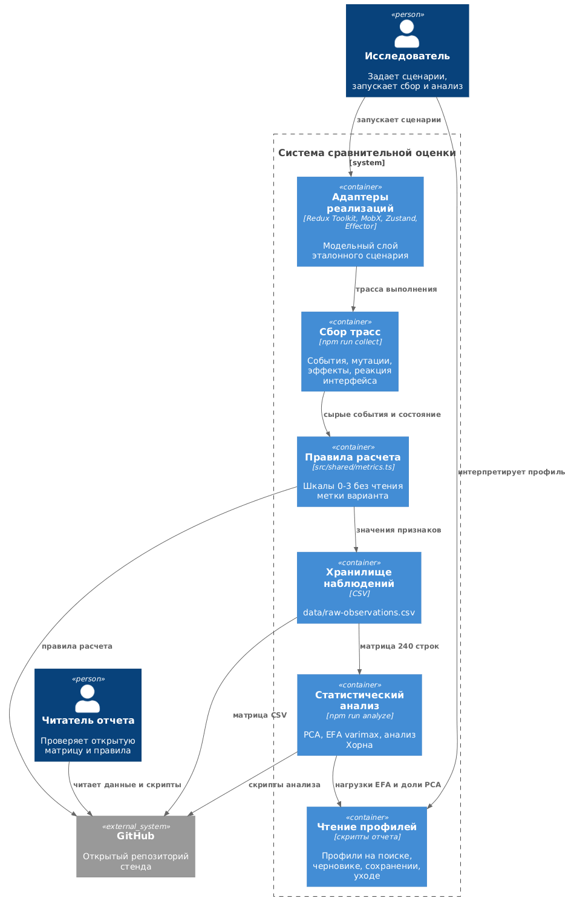
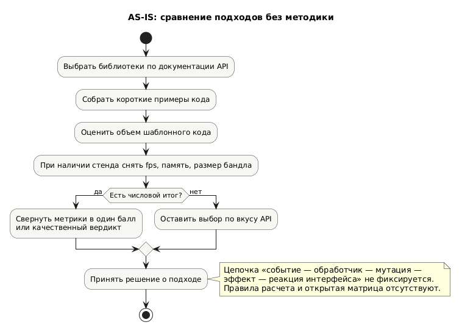
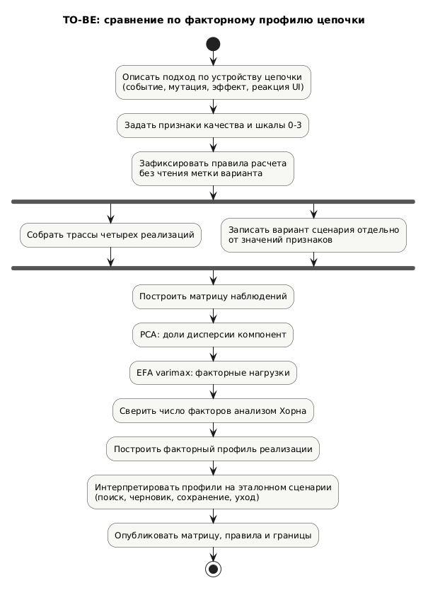

# ЛР 3 — проектирование

**Тема ВКР:** Разработка методики сравнительной оценки подходов к управлению состоянием в одностраничных веб-приложениях на основе факторного анализа качества логических цепочек

**Автор или участники команды:** Филатов Арсений Сергеевич

## 1. Предметная область и требования

### Описание предметной области

Предмет ВКР — качество логической цепочки в одностраничном приложении: путь от события через обработчик и мутацию состояния к побочному эффекту и реакции интерфейса. Сравниваются подходы к управлению состоянием: однонаправленный поток, реактивные зависимости, минимальное хранилище, событийный граф и диаграммы состояний. На стенде четыре реализации: Redux Toolkit, MobX, Zustand и Effector. Диаграммы состояний входят в разбор подходов и на стенд не добавляются.

Система этой лабораторной — не само SPA, а контур методики: сбор трасс, расчет признаков, факторный анализ и чтение профилей. Пользователь — исследователь. Читатель отчета проверяет открытую матрицу и правила. Результат сравнения — факторный профиль, не рейтинг библиотек.

Текущий стенд уже дает 240 наблюдений. Часть правил расчета читает метку варианта `defect`. Проектирование фиксирует целевой контур, в котором эта зависимость снята, PCA и EFA разделены, число факторов сверяется анализом Хорна, профили читаются на эталонном сценарии.

### Функциональные требования

| ID | Требование | Как проверить выполнение |
|---|---|---|
| FR-01 | Система фиксирует описание подхода по устройству цепочки: где заданы событие, обработчик, мутация, эффект и реакция интерфейса. | Для каждого подхода заполнены эти пять мест; пустых обязательных полей нет. |
| FR-02 | Система хранит признаки качества цепочки и шкалы 0-3. | Справочник признаков совпадает с правилами расчета; значения вне 0-3 не принимаются. |
| FR-03 | Признаки считаются по правилам, которые не читают метку варианта `defect`. | В `metrics.ts` нет обращения к полю варианта; корреляция сериализуемости с меткой не равна −1,00. |
| FR-04 | Система собирает матрицу наблюдений по четырем реализациям, сценариям и вариантам. | Строка матрицы однозначно задается тройкой «реализация × сценарий × вариант»; трасса приложена. |
| FR-05 | По матрице считаются PCA и отдельно EFA с вращением varimax; число факторов сверяется анализом Хорна. | В отчете анализа есть доли дисперсии компонент, таблица нагрузок EFA и результат Хорна. |
| FR-06 | Для реализации строится факторный профиль, а не единый балл. | На выходе вектор по факторам EFA, без свертки в рейтинг. |
| FR-07 | Профили читаются на эталонном сценарии: поиск, черновик, сохранение, уход со страницы. | Для четырех реализаций есть профили именно на этом сценарии. |
| FR-08 | Матрица, правила расчета и границы методики публикуются в открытом репозитории. | По ссылке доступны CSV, `metrics.ts` и скрипты анализа. |

### Нефункциональные требования

| ID | Требование | Как проверить выполнение |
|---|---|---|
| NFR-01 | Сбор и анализ воспроизводимы командами `npm run collect` и `npm run analyze`. | Повторный запуск на той же ревизии дает ту же матрицу и те же таблицы анализа. |
| NFR-02 | Исходные данные и скрипты открыты. | Репозиторий https://github.com/xWxfFle/ui-state-determinism доступен без учетной записи. |
| NFR-03 | Метка варианта хранится отдельно от значения признака и не входит в правило расчета. | В модели данных `defect_label` принадлежит `Variant`, а `Score.rule_id` ссылается только на правило. |
| NFR-04 | Трасса выполнения журналируется: событие, мутация, эффект, реакция интерфейса. | По `trace_ref` восстанавливается цепочка наблюдения. |
| NFR-05 | Значение признака прослеживается до правила в `src/shared/metrics.ts`. | У каждой оценки есть `rule_id`, совпадающий с функцией расчета. |
| NFR-06 | В матрице нет персональных данных. | Поля наблюдения — библиотека, сценарий, вариант, признаки, ссылка на трассу. |

## 2. Обзор нотаций и видов диаграмм

| Нотация или вид диаграммы | Что описывает | Сильные стороны |
|---|---|---|
| BPMN | Бизнес-процессы, события, развилки, дорожки ролей | Понятный AS-IS / TO-BE для процесса сравнения подходов |
| IDEF0 | Функции и их входы, выходы, управление, механизмы | Декомпозиция методики на шаги без привязки к коду |
| ER-модель | Сущности, атрибуты, связи; основа модели данных | Явно отделяет вариант сценария от оценки признака |
| DFD | Потоки данных между процессами и хранилищами | Показывает путь трассы к матрице и к анализу |
| UML, варианты использования | Акторы и функции системы | Прямое покрытие FR-01…FR-08 |
| UML, диаграмма классов | Структура объектов и отношения | Близка к ER, удобна, если модель живет в коде |
| UML, диаграмма активности | Поведение, параллельные шаги, условия | AS-IS и TO-BE без лишней BPMN-инфраструктуры |
| UML, диаграмма компонентов | Состав системы и зависимости модулей | Связывает адаптеры, сбор, правила и анализ |
| C4, уровень контейнеров | Архитектура: люди, контейнеры, внешние системы | На одном рисунке стенд, GitHub и потоки данных |
| DMN | Правила принятия решений | Подходит для шкал 0-3, если правила вынести из кода |

## 3. Выбор нотаций для проекта

Для ВКР взяты четыре позиции: варианты использования, диаграмма активности, ER и C4. BPMN, IDEF0, DFD, классы, компоненты и DMN остаются в обзоре: их задачи закрывают выбранные схемы.

| Нотация или вид диаграммы | Что моделируем | Связанные требования | Почему подходит |
|---|---|---|---|
| UML, варианты использования | Взаимодействие исследователя и читателя с контуром методики | FR-01…FR-08 | Каждое функциональное требование видно как отдельный прецедент |
| UML, диаграмма активности | Бизнес-логика сравнения: AS-IS без системы и TO-BE с системой | FR-01, FR-03, FR-05, FR-06, FR-07; NFR-03 | На схеме перехода видно, где появляется профиль вместо одного балла |
| ER-модель | Структура наблюдений, признаков, компонент PCA, факторов EFA | FR-02, FR-03, FR-04, FR-06; NFR-03, NFR-05, NFR-06 | Данные отделяют `Variant.defect_label` от `Score`; PCA не смешан с EFA |
| C4, контейнеры | Компоненты стенда и потоки трасс, оценок и скриптов | FR-04, FR-05, FR-08; NFR-01, NFR-02, NFR-04, NFR-05 | Журнал трассы, команды сбора и открытый GitHub читаются как архитектурные решения |

## 4. Модели системы

### Диаграмма вариантов использования (UML)

**Диаграмма:**

**Пояснение модели:** Исследователь описывает подход, задает шкалы, собирает матрицу, считает PCA и EFA, строит профиль и читает его на эталонном сценарии. Читатель отчета входит только в UC8: открытая матрица, правила и границы.

**Отраженные функциональные требования и элементы модели:** UC1…UC8 совпадают с FR-01…FR-08. UC3 отдельно от UC4: расчет без метки варианта не сливается со сбором строк.

**Нефункциональные требования и проектные решения:** UC8 держит NFR-02. Доступ читателя ограничен чтением опубликованных артефактов, без прав менять правила расчета.

### ER-модель наблюдений и факторов

**Диаграмма:**

**Пояснение модели:** Строка наблюдения связывает реализацию, сценарий и вариант. Оценка (`Score`) ссылается на признак и правило, не на метку дефекта. Фактор EFA и нагрузка живут отдельно от компоненты PCA с долей дисперсии. Профиль строится по реализации, фактору и эталонному сценарию (`Scenario.is_reference`).

**Отраженные функциональные требования и элементы модели:** FR-02 — справочник `Feature` и шкала. FR-03 и FR-04 — `Score` без атрибута `defect_label`. FR-06 — `Profile` как вектор по факторам. FR-07 — связь профиля с эталонным сценарием.

**Нефункциональные требования и проектные решения:** NFR-03 — `defect_label` только у `Variant`. NFR-05 — `Score.rule_id`. NFR-06 — в сущностях нет ФИО, почты и идентификаторов пользователя. Заметка у `PCAComponent` фиксирует, что долю дисперсии PCA нельзя приписывать факторам EFA.

### C4, уровень контейнеров

**Диаграмма:**

**Пояснение модели:** Адаптеры четырех реализаций отдают трассу сборщику. Правила расчета пишут значения в CSV. Анализ читает матрицу и отдает нагрузки EFA и доли PCA в контур чтения профилей. GitHub — внешняя система публикации.

**Отраженные функциональные требования и элементы модели:** FR-04 — сбор трасс и CSV. FR-05 — контейнер анализа с PCA, EFA varimax и Хорном. FR-08 — публикация матрицы, правил и скриптов.

**Нефункциональные требования и проектные решения:** NFR-01 — команды `npm run collect` и `npm run analyze` на контейнерах. NFR-02 — открытый GitHub. NFR-04 — журнал трассы в контейнере сбора. NFR-05 — правила в `src/shared/metrics.ts`.

## 5. AS-IS и TO-BE

**Выбранная нотация:** UML, диаграмма активности

### AS-IS — текущее состояние

**Диаграмма:**

**Описание и ограничения:** Подходы выбирают по документации API, коротким примерам и объему шаблонного кода. Если есть стенд производительности, метрики сворачивают в один балл или оставляют качественный вердикт. Цепочка не фиксируется. Правил расчета и открытой матрицы нет. Различие подходов по качеству цепочки на этой схеме проверить нельзя.

### TO-BE — предлагаемое состояние

**Диаграмма:**

**Описание изменений:** Сначала описывается устройство цепочки и задаются признаки со шкалами 0-3. Правила расчета фиксируются без чтения метки варианта. Трассы и метка варианта пишутся раздельно, затем собирается матрица. PCA дает доли дисперсии, EFA с varimax — нагрузки, число факторов сверяется Хорном. Профиль читается на эталонном сценарии и публикуется вместе с правилами.

### Обоснование перехода

На AS-IS решение стоит после свертки в балл или после оценки API. На TO-BE этот шаг заменен чтением профиля. Параллельные ветки «трассы» и «метка варианта» закрывают NFR-03: метка больше не смешивается с расчетом. Последовательность PCA → EFA → Хорн закрывает FR-05 и замечание к ЛР 2: 77,4 % относятся к первым трем компонентам PCA, не к факторам EFA. Публикация в конце схемы закрывает FR-08 и NFR-02.

Существующий стенд — заготовка TO-BE, не AS-IS. В заготовке еще живет чтение метки `defect`. Целевой процесс это чтение убирает.

## 6. Выводы

Варианты использования, активность, ER и C4 покрывают предмет ВКР с трех сторон: кто что делает, как идет процесс сравнения, как устроены данные, как связаны контейнеры стенда.

Функциональные требования FR-01…FR-08 читаются на юзкейсах и на TO-BE. Нефункциональные NFR-01…NFR-06 читаются на C4 и ER: команды запуска, открытый репозиторий, отделение метки варианта, журнал трассы, `rule_id`, отсутствие персональных полей.

Улучшение TO-BE относительно AS-IS видно в трех местах схемы: раздельная запись трассы и варианта; две процедуры анализа вместо одного балла; интерпретация профиля на эталонном сценарии вместо выбора по API.

Этап проектирования показал согласованность контура: процесс TO-BE пишет в сущности ER, контейнеры C4 реализуют те же потоки, прецеденты UC1…UC8 не требуют функций вне этих потоков. Реализация ВКР дальше пересчитывает матрицу по правилам без метки варианта и добавляет анализ Хорна; новый внешний сервис для этого не нужен.
